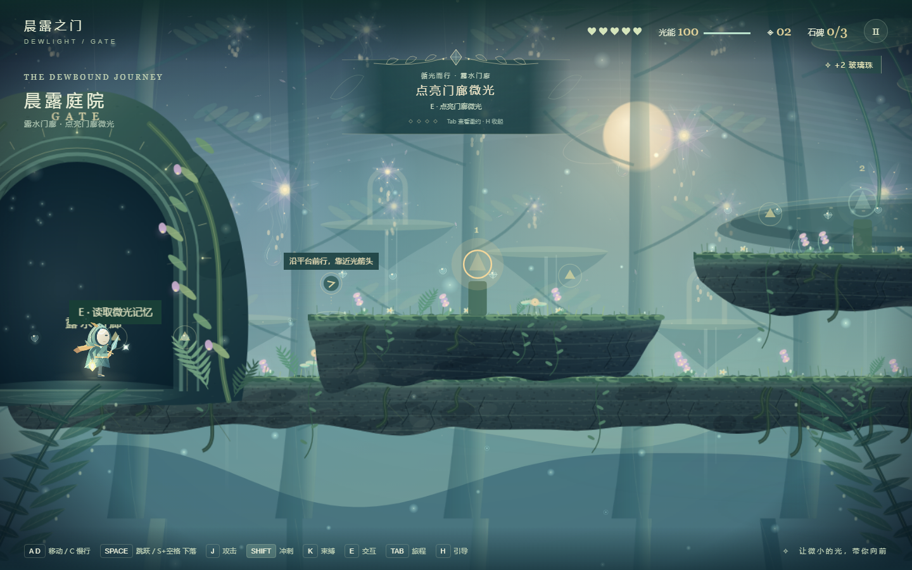
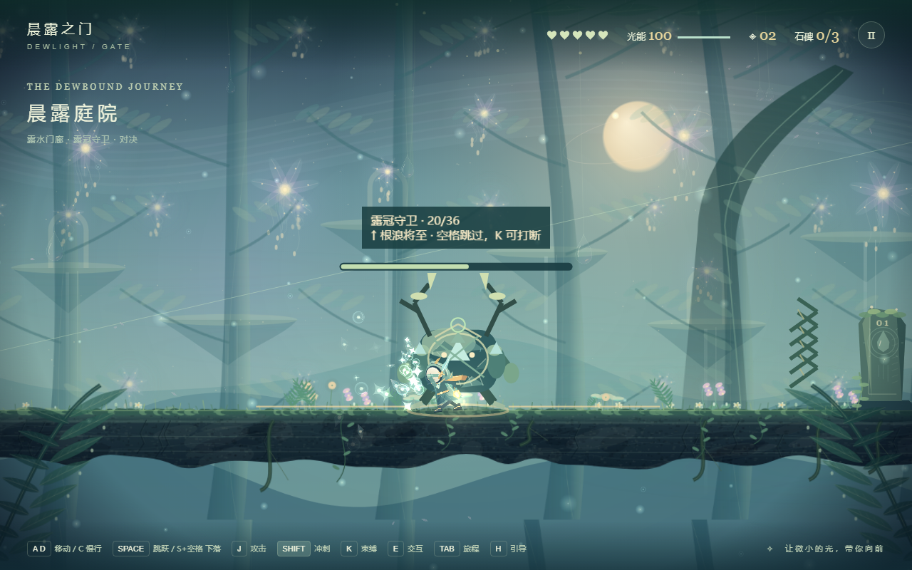

# 晨露之门 · Dewlight Gate

一款温柔奇幻风格的 2D 横版轻动作冒险。提起玻璃灯，从 GATE 出发，穿过晨露、玻璃与藤蔓交织的庭院，唤醒三座石碑。

**[在线试玩](https://sekai6.github.io/dewlight-gate/)** · [Boss 战斗录像](docs/media/boss-duel.webm) · [MIT License](LICENSE)



## 游戏特色

- 安全开场、短平台练习与第一关小 Boss「露冠守卫」。
- 移动、跳跃、近战、冲刺、藤蔓束缚与场景交互；冲锋和根浪提供动作与地面预警。
- 三个地区、20 枚主线灯环与三座石碑；可选浅溪另有 4 枚灯环。
- 日志、背包、暂停旅程页、自动存档和检查点；失败保留收集进度。
- 自制程序绘图与矢量风格美术，支持减少动态、镜头震动开关和清晰界面。
- 默认 Canvas 渲染；可选 WebGPU 后处理，不支持时自动回退。



## 操作

请使用桌面浏览器与键盘，推荐窗口至少 1024 像素宽。

| 按键 | 操作 |
| --- | --- |
| A / D 或左右方向键 | 移动 |
| C | 慢行 |
| 空格 | 跳跃 |
| S / ↓ + 空格 | 穿下平台 |
| J | 近战；Boss 战中可按住连击 |
| Shift | 冲刺，短暂受伤保护 |
| K | 藤蔓束缚敌人或固定叶台 |
| E | 交互、接通灯环、唤醒石碑 |
| Tab / Esc | 旅程页 / 暂停 |
| H | 显示或收起寻路引导 |
| R | Boss 战中回入口重试 |

Boss 普通命中削 1 点生命，疲惫或束缚时削 2 点。红色箭纹预告冲锋，金色地纹预告可跳过的根浪；K 能打断并创造破绽。第一碑后到发光门按 E 进入下一地区。

## 本地运行

需要 Node.js **22.18 或更新的 22.x 版本**与 npm。

```sh
npm ci
npm run dev
```

打开终端显示的地址。Windows PowerShell 若阻止 npm.ps1，请改用 `npm.cmd`。

```sh
npm run build
npm run preview
```

生产文件位于 `dist/`，可部署到静态网站；资源使用相对路径。正常生产构建不会暴露开发调试入口。

## 开发与验证

技术栈：TypeScript、Vite、Phaser 3、Canvas、HTML/CSS；没有后端、账号系统或外部 API。音效由 Web Audio 合成，在首次用户操作后启用。

```sh
npm test
npm run format:check
npx playwright install chromium
npm run test:e2e
```

Playwright 自动启动开发服务；本地可复用已有服务。CI 检查格式、单元测试、浏览器测试及构建，通过后自动部署 GitHub Pages；PR 只检查。原生 WebGPU 检查按适配器能力跳过，跳过不代表 GPU 验证通过。

`scripts/` 保留专项复现脚本，生成结果写入未提交的 `artifacts/`。完整流程检查使用实时引导与普通控制完成灯环、Boss 和三碑；局部演示脚本可能定位初始场景，不能替代完整通关证据。

## 存档与限制

- 使用当前浏览器的 localStorage 自动存档；清理网站数据会清空进度，没有云同步。存储不可用时仍能游玩。
- 仅支持桌面键盘，暂不支持触屏、手柄、配音或多人游戏。
- 首次加载需下载游戏包；加载后可离线继续当前页面，没有离线安装或离线刷新保证。
- WebGPU 需要 HTTPS 和兼容浏览器/显卡，显示 SDR 画面；不可用时使用 Canvas 画面。
- 未完成的 Boss 战刷新后重新开始；已击败结果永久保留。

## 参与项目

欢迎提交问题与 Pull Request。反馈请附浏览器、窗口尺寸、复现步骤及截图；提交改动前运行上述检查。请勿提交凭据、环境变量文件、依赖、构建产物或测试录像目录。

当前发布素材仅保留两张截图和一段录像。历史说明见 [版本迭代记录](docs/RELEASE-HISTORY.md) 与 [验收记录](AUDIT.md)，其中旧版本数字及本地证据路径不代表当前公开版本。

## 许可

源码与项目自制美术使用 [MIT](LICENSE)。Phaser 等依赖遵循各自的开源许可。
